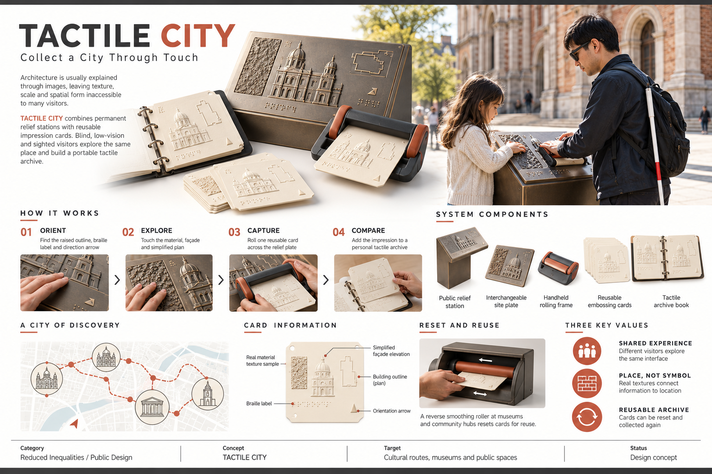

# iF Student Concept Board

A reusable Codex skill for researching recent iF Design Student Award patterns, developing distinctive SDG-aligned product/service concepts, and generating polished horizontal competition boards with ImageGen.



## What it does

- researches current iF criteria and official winner patterns;
- identifies saturated student-design topics;
- scores directions for problem-solving, ethics, solidarity, design relevance, and feasibility;
- expands an idea into a product-service system;
- writes concise English board copy;
- builds structured ImageGen prompts for 3:2 competition boards;
- checks claims, product consistency, safety, accessibility, and sustainability;
- saves versioned deliverables into the active workspace.

## Install

Copy this folder into your Codex skills directory:

```text
%USERPROFILE%\.codex\skills\if-student-concept-board
```

Restart or refresh Codex if the skill does not appear immediately.

## Use

Invoke the skill explicitly:

```text
Use $if-student-concept-board to research current iF student award trends,
avoid medical and emergency-device clichés, and propose ten cultural or
public-space product concepts.
```

```text
Use $if-student-concept-board to turn this community-service idea into a
complete product system, English board copy, and a horizontal iF-style board.
```

```text
Use $if-student-concept-board to review my concept against the current iF
student criteria and identify unsupported claims or missing service logic.
```

## Structure

```text
if-student-concept-board/
|-- SKILL.md
|-- agents/openai.yaml
|-- assets/tactile-city-board-reference.png
`-- references/
    |-- research-and-concept.md
    |-- board-generation.md
    |-- tactile-city-case-study.md
    `-- quality-checklist.md
```

## TACTILE CITY case study

TACTILE CITY was developed after a review of recent iF student winners showed strong signals around dignity, shared participation, strategic simplicity, and real maintenance/reuse loops. The concept lets blind, low-vision, and sighted visitors explore the same architectural relief station and create reusable tactile impressions of places.

The case study documents the move from a crowded health/safety topic space to inclusive public design, the five-part product-service system, the board hierarchy, ethical boundaries, and the next prototype tests.

## Notes

- The workflow uses official iF sources for time-sensitive award research.
- The included board is a generated case-study reference, not an iF award claim.
- Do not add an iF winner logo, invented entrant information, test results, certifications, or impact statistics.
- User-provided reference boards should remain layout references only unless the user owns publication rights.

